# Architecture Document — Statistical Service with Embedded Analytics

**Supplier Proposal — Architecture & Technology**

**Client:** Health Insights AB  
**Document Version:** 1.0  
**Date:** 2026-02-27  
**Classification:** Tender Response — Confidential

---

## Table of Contents

1. [Executive Summary](#1-executive-summary)
2. [Proposal A — Azure + Power BI Embedded](#2-proposal-a--azure--power-bi-embedded)
   - 2.1 [High-Level Architecture](#21-high-level-architecture)
   - 2.2 [Component Breakdown](#22-component-breakdown)
   - 2.3 [Identity & Access — Two Sub-Options](#23-identity--access--two-sub-options)
   - 2.4 [Data Flow](#24-data-flow)
   - 2.5 [Report Layer & RLS](#25-report-layer--rls)
   - 2.6 [Small Numbers Protection](#26-small-numbers-protection)
   - 2.7 [Web Portal](#27-web-portal)
   - 2.8 [CSV Upload & Validation](#28-csv-upload--validation)
   - 2.9 [Security & Compliance](#29-security--compliance)
   - 2.10 [Operations & Monitoring](#210-operations--monitoring)
   - 2.11 [Scalability — Adding New Diagnoses](#211-scalability--adding-new-diagnoses)
3. [Proposal B — Open Source Alternative](#3-proposal-b--open-source-alternative)
   - 3.1 [High-Level Architecture](#31-high-level-architecture)
   - 3.2 [Component Breakdown](#32-component-breakdown)
   - 3.3 [Sub-Option B1 — Apache Superset](#33-sub-option-b1--apache-superset)
   - 3.4 [Sub-Option B2 — Metabase](#34-sub-option-b2--metabase)
   - 3.5 [Identity & Access — Keycloak](#35-identity--access--keycloak)
   - 3.6 [Data Flow](#36-data-flow)
   - 3.7 [Report Layer & Row-Level Security](#37-report-layer--row-level-security)
   - 3.8 [Small Numbers Protection](#38-small-numbers-protection)
   - 3.9 [Web Portal](#39-web-portal)
   - 3.10 [CSV Upload & Validation](#310-csv-upload--validation)
   - 3.11 [Security & Compliance](#311-security--compliance)
   - 3.12 [Operations & Monitoring](#312-operations--monitoring)
   - 3.13 [Scalability — Adding New Diagnoses](#313-scalability--adding-new-diagnoses)
4. [Detailed Comparison — Proposal A vs Proposal B](#4-detailed-comparison--proposal-a-vs-proposal-b)
   - 4.1 [Requirement-by-Requirement Mapping](#41-requirement-by-requirement-mapping)
   - 4.2 [Cost Comparison Summary](#42-cost-comparison-summary)
   - 4.3 [Risk Comparison](#43-risk-comparison)
   - 4.4 [Recommendation](#44-recommendation)
5. [Optional Requirements Mapping (B1–B5)](#5-optional-requirements-mapping-b1b5)
6. [Glossary](#6-glossary)

---

## 1. Executive Summary

We present **two complete architecture proposals** for the Health Insights statistical service:

- **Proposal A (Azure + Power BI Embedded):** The reference architecture using Microsoft's ecosystem. This is the most aligned with the procurement specification and offers the fastest path to delivery with the lowest implementation risk.

- **Proposal B (Open Source):** An alternative using open-source analytics (Apache Superset or Metabase) with PostgreSQL, Keycloak for identity, and containerised deployment on Azure. This offers zero licence cost but higher implementation effort.

Both proposals meet all Shall requirements (S1–S10). Both are deliberately simple, cost-optimised for the stated usage profile (6–8 companies, 1–3 users each, office hours, very low concurrency), and designed for reuse across future diagnoses.

---

## 2. Proposal A — Azure + Power BI Embedded

### 2.1 High-Level Architecture

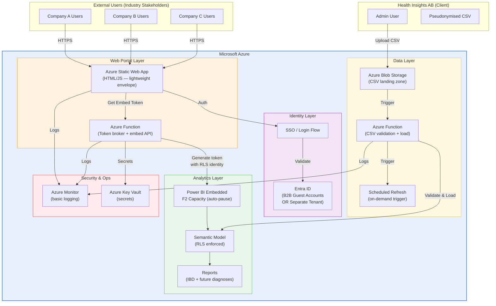

### 2.2 Component Breakdown

| Component | Azure Service | Purpose | Cost Driver |
|-----------|--------------|---------|-------------|
| Web Portal | Azure Static Web Apps (Free tier) | Login, navigation, report embed | Free |
| Token Broker | Azure Functions (Consumption plan) | Generate Power BI embed tokens with RLS context | ~0 (very low invocations) |
| Identity | Entra ID (B2B or separate tenant) | SSO, user management, guest access | Free tier covers this scale |
| Analytics Engine | Power BI Embedded (F2 SKU, auto-pause) | Render reports, enforce RLS | **Primary cost driver** ~SEK 2,500–4,000/month |
| Semantic Model | Power BI Dataset | Data model, measures, RLS rules | Included in capacity |
| Reports | Power BI Reports (.pbix) | All charts, filters, comparisons per Appendix A | Included in capacity |
| CSV Storage | Azure Blob Storage | Landing zone for uploads | Negligible |
| CSV Validation | Azure Functions (Consumption) | Format checks, schema validation | ~0 |
| Secrets | Azure Key Vault | Service principal credentials, connection strings | Negligible |
| Logging | Azure Monitor (basic) | Operation logs, error tracking | Minimal |

**Estimated monthly recurring: SEK 3,000–5,000** (dominated by Power BI Embedded capacity).

### 2.3 Identity & Access — Two Sub-Options

We propose both options as specified. The Client selects based on operational preference.

#### Option A: Guest Accounts in Client's Entra ID

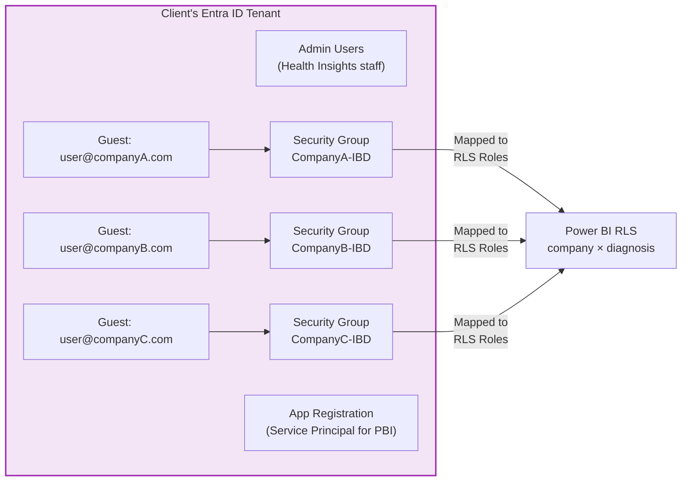

| Aspect | Details |
|--------|---------|
| How it works | External users are invited as B2B guests into the Client's own Entra ID. Each guest is assigned to a security group matching their company × diagnosis access. |
| Onboarding | Admin invites guest → assigns to security group → RLS enforces data segregation automatically. |
| Pros | Simplest setup; no additional tenant to manage; free at this scale; single identity plane. |
| Cons | Guests visible in Client's directory; if Client has strict tenant policies, may require governance approval. |
| Cost | **SEK 0/month** (Entra ID free tier supports B2B guests at this scale). |

#### Option B: Separate Tenant for the Service

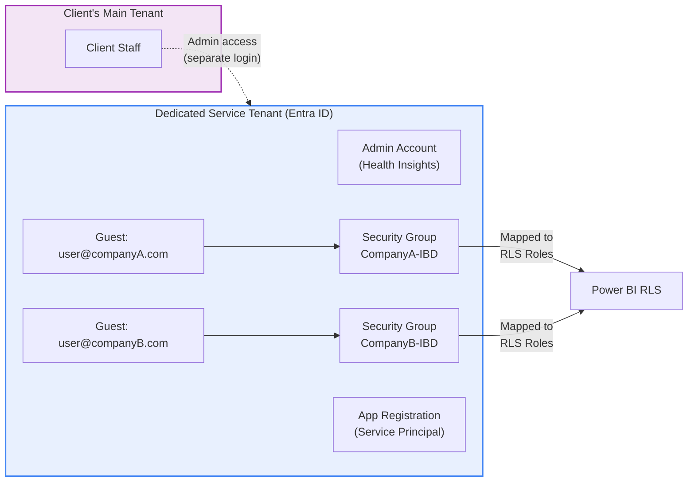

| Aspect | Details |
|--------|---------|
| How it works | A new Entra ID tenant is created solely for the statistical service. External users are invited as B2B guests into this tenant. The Client's main tenant remains untouched. |
| Onboarding | Same as Option A but in the isolated tenant. |
| Pros | Full isolation from Client's corporate tenant; no governance conflicts; clean separation of concerns. |
| Cons | Extra tenant to manage; admin must switch context; slightly more setup. |
| Cost | **SEK 0/month** (Entra ID free tier; the tenant itself is free). |

#### Identity Comparison

| Criterion | Option A (Guest in Client Tenant) | Option B (Separate Tenant) |
|-----------|-----------------------------------|---------------------------|
| Setup complexity | Low | Medium |
| Ongoing admin effort | Low | Low (same operations) |
| Isolation | Shared tenant | Full isolation |
| Governance risk | May need Client IT approval | None — independent |
| Cost | SEK 0 | SEK 0 |
| **Recommendation** | **Best for Clients with permissive tenant policies** | **Best if Client wants clean separation** |

### 2.4 Data Flow

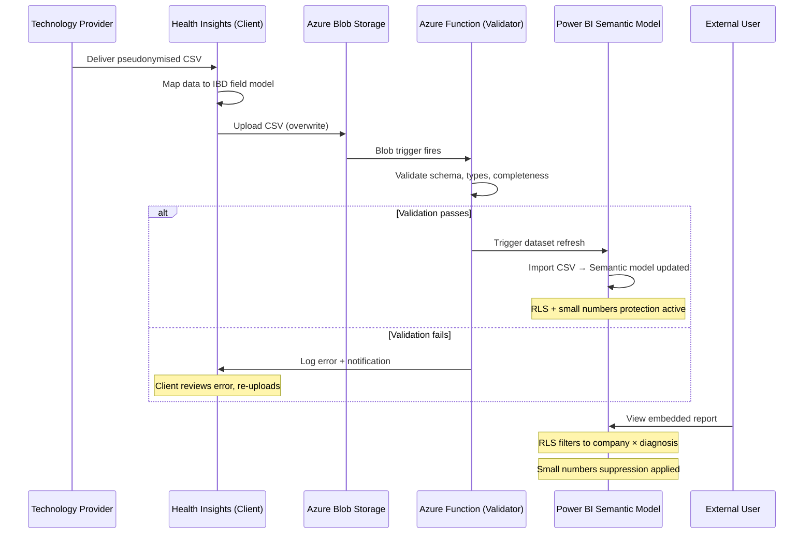

**Data flow steps mapped to specification Section 9:**

| Spec Step | Implementation |
|-----------|---------------|
| 1. Data collection | Technology Provider (outside scope) |
| 2. Data processing | Technology Provider (outside scope) |
| 3. Approval | Data Owner (outside scope) |
| 4. CSV delivery | Technology Provider → Client (outside scope) |
| 5. Upload (overwrite) | Client uploads to Azure Blob Storage |
| 6. Field mapping | Client maps to IBD schema (outside scope, documented) |
| 7. Processing & presentation | Power BI Embedded with RLS |

### 2.5 Report Layer & RLS

#### RLS Model

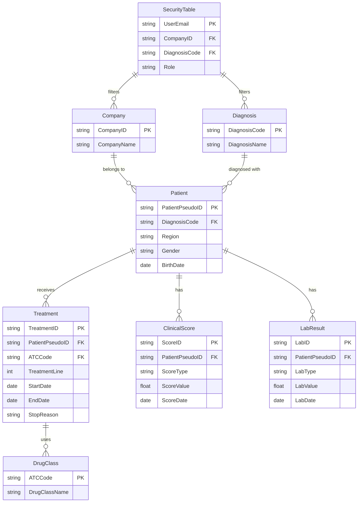

**RLS enforcement:**

- A `SecurityTable` maps `UserEmail` → `CompanyID` × `DiagnosisCode`
- A DAX filter on the `SecurityTable` restricts all queries:
  ```
  [UserEmail] = USERPRINCIPALNAME()
  ```
- This cascades through relationships to filter Patient, Treatment, ClinicalScore, and LabResult tables
- The embed token is generated with the user's identity, activating the correct RLS role

**Onboarding a new company × diagnosis combination:**

1. Add row(s) to `SecurityTable` in the CSV/data source
2. Create Entra ID security group (e.g., `CompanyX-DiagnosisY`)
3. Invite user(s) as guests, assign to group
4. Refresh dataset — new combination is active

#### Report Structure (per Appendix A)

| Report | Chart Type | Key Filters | Power BI Implementation |
|--------|-----------|-------------|------------------------|
| Table 1 (Demographics) | Text/Matrix | Date range, ATC, Gender, ICD, Region, Age, Treatment status | Card visuals + matrix |
| Patients Ever Treated | Line graph | ATC, ICD, Region, Age, Treatment status | Line chart, year on X-axis |
| Treatment Lines per Diagnosis | Bar (stacked) | Diagnosis year, ICD, Region, Age, Treatment status | Stacked bar chart |
| Treatment Lines per Drug Class | Bar (stacked) | Diagnosis year, ICD, Region, Age, Treatment status | Stacked bar chart |
| Drug Class Distribution | Bar | ICD, Region, Age, Treatment status, Diagnosis year | Clustered bar |
| New Line Initiations | Bar (stacked by drug) | Diagnosis year, ATC, ICD, Region, Age, Treatment status | Stacked bar |
| Persistence / Drug Survival | Kaplan-Meier | ATC, ICD, Region, Age, Line of treatment | Custom visual or DAX survival curve |
| Reason for Stopping | Bar | ATC, ICD, Region, Age | Clustered bar |
| Harvey Bradshaw Outcomes | Bar (grouped) | ATC, ICD, Region, Age, Treatment status, Line | Grouped bar (4 categories) |
| Mayo Outcomes | Bar (grouped) | ATC, ICD, Region, Age, Treatment status, Line | Grouped bar (4 categories) |
| Lab Outcomes (CRP/Hb/Calprotectin) | Bar | Lab type dropdown, NKRR flag, ATC, ICD, Region, Age, Treatment, Line | Bar with slicer for lab type |
| PGA Scores | Bar (grouped) | ATC, ICD, Region, Age, Treatment status, Line | Grouped bar (5 categories) |
| Switch Analysis | Pie charts | ATC, ICD, Region, Age, Treatment status, Line | Pie chart pair (before/after) |
| Per Company: Table 1 | Text/Matrix | Locked to company's ATC code | Filtered duplicate page |
| Per Company: Patients Treated | Line | Locked to company's ATC code | Filtered duplicate page |
| Per Company: Treatment Lines | Bar | Locked to company's ATC code | Filtered duplicate page |

**Comparison feature:** Implemented using Power BI bookmarks and side-by-side visuals on the same page, allowing users to apply different filter sets to left vs right panels (as described in Appendix A's conceptual model).

### 2.6 Small Numbers Protection

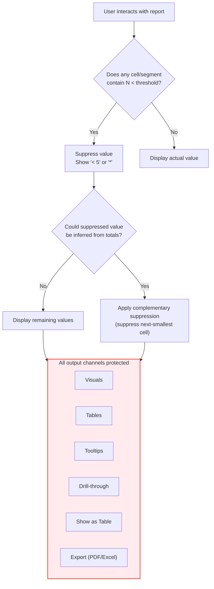

**Method:** Primary suppression (replace values < threshold with `*`) plus complementary/secondary suppression to prevent differencing attacks through totals. Implemented via DAX measures that check counts before displaying values.

**Coverage:** Applied at the DAX measure level, meaning it is enforced regardless of output channel — visuals, tables, tooltips, drill-through, "show as table", and exports all use the same measure and thus the same protection.

**Threshold:** Configurable parameter (default: 5), stored as a dataset parameter that the Client can adjust without report modification.

### 2.7 Web Portal

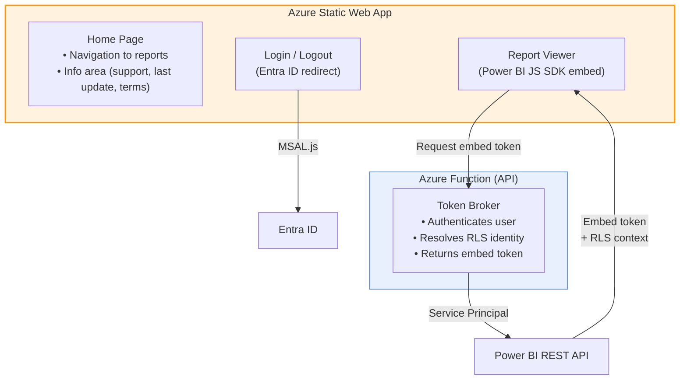

**Implementation:** Single-page static HTML/JS application. No server-side rendering. No custom filter logic — all filtering is within Power BI reports.

**Tech stack:** HTML + vanilla JS (or minimal framework), MSAL.js for auth, Power BI JS SDK for embedding. Hosted on Azure Static Web Apps (free tier).

**Pages:**
- Home / navigation (links to report sections)
- Embedded report viewer (full page, Power BI iframe)
- Info footer (support contact, last data refresh timestamp, terms)

### 2.8 CSV Upload & Validation

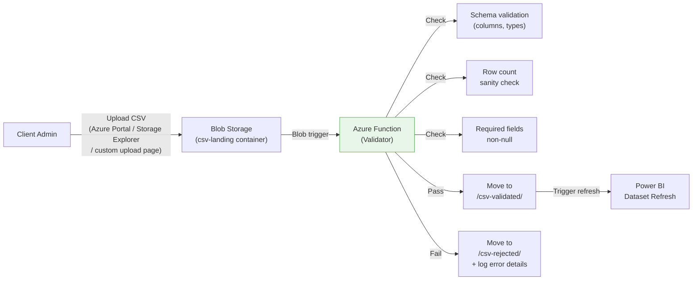

**Upload method:** Client uploads CSV via Azure Storage Explorer (free desktop tool) or a simple upload button in the web portal's admin section. The file overwrites the previous version.

**Validation rules (basic):**
- Column headers match expected schema
- Data types are correct (dates, numbers, codes)
- Required fields are non-null
- Row count is within expected range (sanity check)

**On failure:** File is moved to a rejection folder with error details logged. Client is notified (email or log check).

### 2.9 Security & Compliance

| Requirement | Implementation |
|-------------|---------------|
| GDPR support | All data is pseudonymised before upload. No PII in the solution. DPIA documentation template provided. |
| Proportionate security | No WAF, no private endpoints, no VNet isolation (not needed for low threat profile). HTTPS everywhere. |
| Encryption at rest | Azure default (Storage, Power BI) |
| Encryption in transit | TLS 1.2+ |
| Basic logging | Azure Monitor + Azure Function logs. Covers: login events, upload events, refresh status, errors. |
| Secret management | Azure Key Vault for service principal secrets and connection strings. |
| Access control | Entra ID + RLS (no direct database access for end users). |

### 2.10 Operations & Monitoring

| Aspect | Base Level (Shall) | Optional Extended (B2) |
|--------|-------------------|------------------------|
| Logging | Azure Monitor basic metrics + Function logs | Application Insights, custom dashboards |
| Alerts | None (manual log review) | Email/Teams alerts on refresh failures, login anomalies |
| Uptime monitoring | None | Azure Availability Test |
| Refresh monitoring | Manual check via Power BI service | Automated alerts on failure |
| Cost | SEK 0 (included in Azure free tier) | ~SEK 500–1,000/month |

### 2.11 Scalability — Adding New Diagnoses

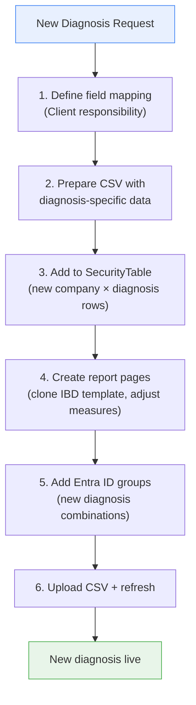

**Reusability design:**
- Same semantic model, extended with diagnosis-specific tables/columns
- Report pages are templated — clone and adjust for new diagnosis
- RLS model is diagnosis-agnostic (SecurityTable handles all combinations)
- Same portal, same upload flow, same infrastructure
- Estimated effort per new diagnosis: **40–80 hours** (report development + testing)

---

## 3. Proposal B — Open Source Alternative

### 3.1 High-Level Architecture

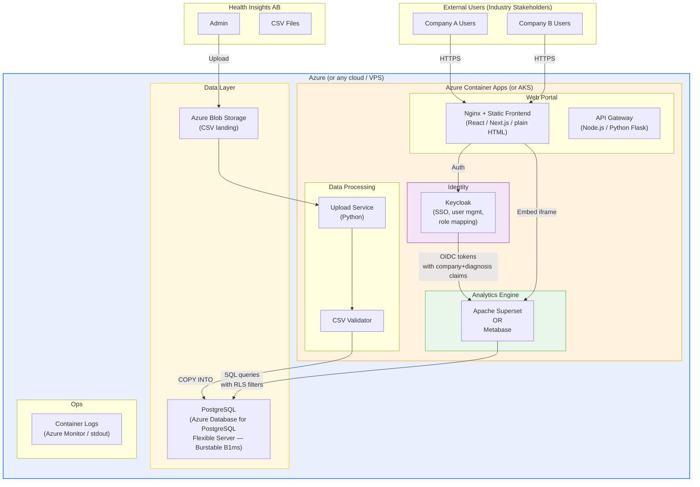

### 3.2 Component Breakdown

| Component | Technology | Purpose | Cost Driver |
|-----------|-----------|---------|-------------|
| Web Portal | Nginx + static files (React/HTML) | Login, navigation, embed analytics | Minimal (container cost) |
| API / Token Broker | Python Flask or Node.js | Manage embed URLs, session handling | Minimal |
| Analytics — Option B1 | **Apache Superset** | Dashboards, charts, filters, embedded views | Zero licence; container cost |
| Analytics — Option B2 | **Metabase** (OSS edition) | Dashboards, charts, filters, embedded views | Zero licence; container cost |
| Identity & SSO | Keycloak | OIDC/SAML SSO, user management, role mapping | Zero licence; container cost |
| Database | PostgreSQL (Azure Flexible B1ms) | Store all analytical data | ~SEK 400–800/month |
| CSV Storage | Azure Blob Storage | Landing zone | Negligible |
| Upload Service | Python script (containerised) | CSV validation and database load | Minimal |
| Container Runtime | Azure Container Apps (Consumption) | Run all containers | ~SEK 500–1,500/month |
| Logging | Container stdout → Azure Monitor | Basic operational logs | Minimal |

**Estimated monthly recurring: SEK 1,500–3,500** (zero licence costs).

### 3.3 Sub-Option B1 — Apache Superset

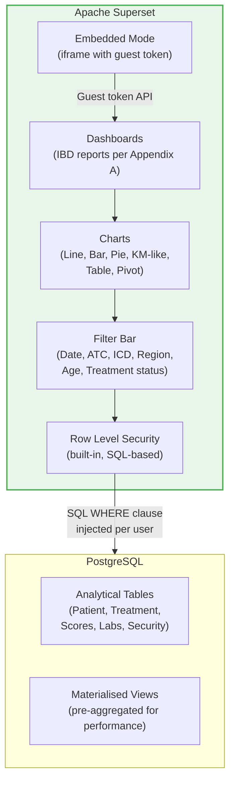

| Aspect | Details |
|--------|---------|
| Chart types | Line, bar (grouped/stacked), pie, table, pivot, big number, area. Supports custom SQL-based charts. |
| Kaplan-Meier | Not built-in. Requires pre-computation in PostgreSQL (SQL window functions) and display as a line/step chart. |
| Filters | Native filter bar with cross-filter support. All filter types from Appendix A are supported. |
| Comparison (side-by-side) | Tab-based or dashboard row layout. Less native than Power BI bookmarks but achievable. |
| RLS | Built-in. SQL clause injected per user/role. Very flexible. |
| Embedding | Guest token API allows iframe embedding without Superset login. |
| Maturity | Apache top-level project. Large community. Used by Airbnb, Lyft, Dropbox. |
| Complexity | Medium-high. Requires Python/Docker knowledge for operations. |

### 3.4 Sub-Option B2 — Metabase

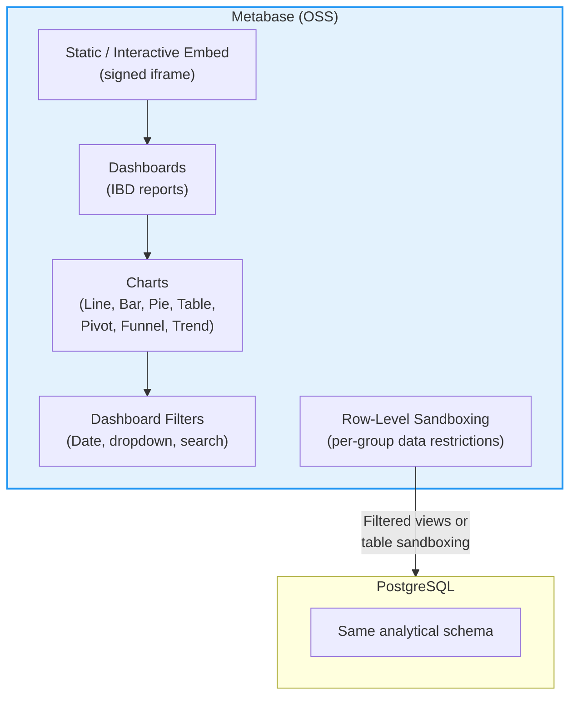

| Aspect | Details |
|--------|---------|
| Chart types | Line, bar, pie, table, pivot, trend, funnel, gauge, map. |
| Kaplan-Meier | Not built-in. Same approach as Superset — pre-compute in SQL, display as step chart. |
| Filters | Dashboard-level filters. Straightforward. |
| Comparison | Side-by-side cards on dashboard. Less flexible than Superset's layout. |
| RLS | "Sandboxing" in OSS edition is limited. Full row-level sandboxing requires **Metabase Pro** (paid). In OSS, RLS must be implemented via PostgreSQL views + connection-per-group or a middleware layer. |
| Embedding | Signed static embeds (OSS) or interactive embeds (Pro). OSS embedding is more limited. |
| Maturity | Very popular, user-friendly. Simpler than Superset. |
| Complexity | Low. Easiest to set up and operate. |
| **Key limitation** | Full RLS and interactive embedding require Metabase Pro (paid licence), which reduces the cost advantage. |

#### Superset vs Metabase Comparison

| Criterion | Apache Superset | Metabase (OSS) | Metabase Pro |
|-----------|----------------|----------------|--------------|
| Licence cost | Free (Apache 2.0) | Free (AGPL) | ~USD 500+/month |
| RLS (built-in) | ✅ Full, SQL-based | ⚠️ Limited in OSS | ✅ Full sandboxing |
| Embedding | ✅ Guest token API | ⚠️ Signed static only | ✅ Interactive embed |
| Chart variety | High | Medium-High | Medium-High |
| Kaplan-Meier | Pre-compute in SQL | Pre-compute in SQL | Pre-compute in SQL |
| Ease of use | Medium | High (most user-friendly) | High |
| Operational complexity | Higher | Lower | Lower |
| Community | Large (Apache project) | Large | N/A |
| **Suitability for this project** | **Best fit for OSS path** | Viable but RLS gap | Good but adds cost |

**Recommendation for Proposal B:** Apache Superset is the stronger fit because it provides built-in RLS and embedding in the free edition, which are critical Shall requirements.

### 3.5 Identity & Access — Keycloak

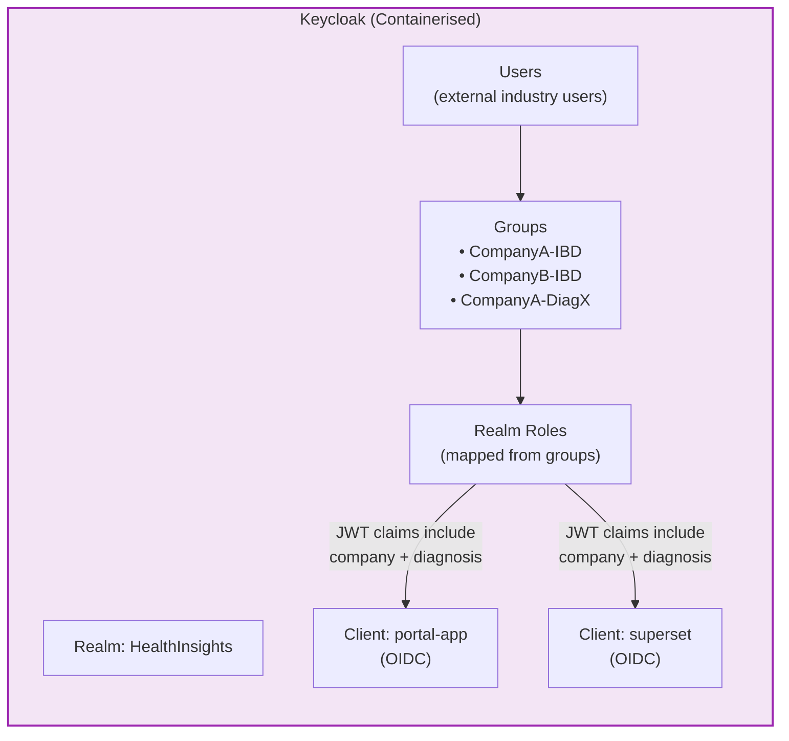

| Aspect | Details |
|--------|---------|
| How it works | Keycloak manages all user identities. External users get local accounts (or can federate with their corporate IdP if desired). Groups encode company × diagnosis access. JWT tokens carry claims used by Superset/Metabase for RLS. |
| SSO | OIDC-based SSO. Single login for portal + analytics. |
| User management | Admin console for creating users, assigning groups. |
| Onboarding | Create user → assign to group → done. |
| Cost | **SEK 0** (open source, runs as container). |
| Operational overhead | Requires container management, PostgreSQL backend (shared with analytics DB), and backup of configuration. |

### 3.6 Data Flow

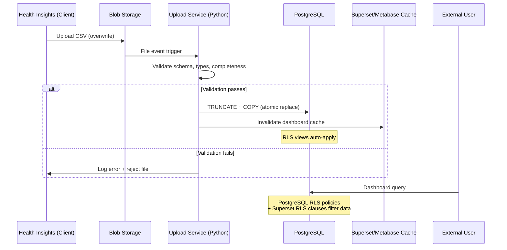

### 3.7 Report Layer & Row-Level Security

**PostgreSQL RLS (database-level):**

```sql
-- Example: Row-level security policy on patient table
ALTER TABLE patient ENABLE ROW LEVEL SECURITY;

CREATE POLICY company_diagnosis_access ON patient
    USING (
        (company_id, diagnosis_code) IN (
            SELECT company_id, diagnosis_code
            FROM user_access
            WHERE user_email = current_setting('app.current_user')
        )
    );
```

**Superset RLS (application-level, additional layer):**

- Superset's built-in RLS allows defining SQL clauses per role
- Example: Role `CompanyA-IBD` gets clause `company_id = 'A' AND diagnosis_code = 'K50'`
- Double enforcement: both PostgreSQL and Superset apply filters

### 3.8 Small Numbers Protection

In the open-source stack, small numbers protection is implemented via **SQL views / materialised views** that apply suppression logic:

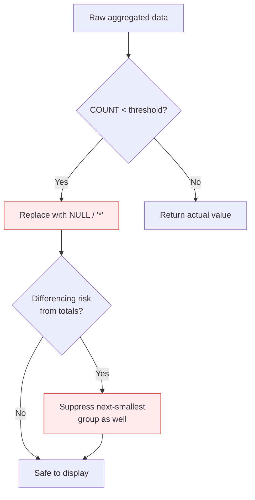

**Implementation approach:**
- All dashboard queries go through **suppression views** (not raw tables)
- Views contain SQL logic: `CASE WHEN count < threshold THEN NULL ELSE count END`
- Complementary suppression is handled by a secondary pass in the view
- Threshold is a configurable parameter in a settings table
- Export protection: Superset/Metabase export functions use the same views, so suppression is enforced

**Difference from Proposal A:** In Power BI, this is done in DAX measures. In the OSS stack, it's done in SQL views. Both achieve the same result, but the SQL approach is more transparent and auditable.

### 3.9 Web Portal

Same minimal approach as Proposal A:

- Static HTML/JS (or lightweight React)
- Served by Nginx container
- Login redirects to Keycloak
- Analytics embedded as iframe (Superset guest token or Metabase signed embed)
- Info area with support contact, last update, terms

No filter logic in the portal — all in the analytics layer.

### 3.10 CSV Upload & Validation

Same flow as Proposal A but with a Python-based upload service:

- Client uploads CSV to Blob Storage (or directly via a simple upload page in the portal admin area)
- Python service validates and loads into PostgreSQL using `TRUNCATE` + `COPY`
- Atomic replacement — no partial data states
- Validation errors logged and reported

### 3.11 Security & Compliance

| Requirement | Implementation |
|-------------|---------------|
| GDPR support | Pseudonymised data only. DPIA documentation provided. |
| Encryption at rest | Azure managed encryption (PostgreSQL, Blob Storage) |
| Encryption in transit | TLS 1.2+ (container-level + Azure load balancer) |
| Logging | Container stdout → Azure Monitor. Keycloak audit logs. |
| Secret management | Azure Key Vault or Kubernetes secrets |
| Access control | Keycloak (identity) + PostgreSQL RLS + Superset RLS (triple layer) |

### 3.12 Operations & Monitoring

| Aspect | Base Level | Notes |
|--------|-----------|-------|
| Container management | Azure Container Apps (serverless) or AKS (if more control needed) | Container Apps recommended for simplicity |
| Database backup | Azure-managed PostgreSQL automatic backups | Included in service |
| Updates | Container image updates for Superset/Metabase/Keycloak | Requires periodic maintenance |
| Monitoring | Container logs + Azure Monitor | Basic level |
| **Operational overhead** | **Higher than Proposal A** | More components to manage |

### 3.13 Scalability — Adding New Diagnoses

Same model as Proposal A:

1. Define field mapping (Client)
2. Add tables/views in PostgreSQL for new diagnosis
3. Create dashboard pages (clone template)
4. Add RLS policies / Superset RLS clauses
5. Add Keycloak groups
6. Upload CSV

Estimated effort per new diagnosis: **50–100 hours** (slightly more than Proposal A due to SQL view creation and dashboard rebuilding).

---

## 4. Detailed Comparison — Proposal A vs Proposal B

### 4.1 Requirement-by-Requirement Mapping

#### S1. Overall Delivery

| Req | Description | Proposal A (Azure + PBI) | Proposal B (Open Source) |
|-----|-------------|--------------------------|--------------------------|
| S1.1 | Coherent service, ready for operation | ✅ Fully integrated Azure stack | ✅ Containerised stack, all components included |
| S1.2 | Deliverable to stakeholders without further development | ✅ Handover includes portal, reports, runbook | ✅ Same deliverables |
| S1.3 | Cost-effective, not over-engineered | ✅ Minimal Azure services, F2 auto-pause | ✅ Zero licence cost, minimal infrastructure |
| S1.4 | Standardised cost appendix | ✅ | ✅ |
| S1.5 | v1 vs optional items stated | ✅ | ✅ |

#### S2. Architecture and Technology

| Req | Description | Proposal A | Proposal B |
|-----|-------------|------------|------------|
| S2.1 | Azure or equivalent | ✅ Native Azure | ✅ Runs on Azure (Container Apps) |
| S2.2 | Embedded analytics (PBI Embedded or equivalent) | ✅ Power BI Embedded (app owns data) | ✅ Superset/Metabase embedded (equivalent) |
| S2.3 | Sized for low concurrency, office hours | ✅ F2 with auto-pause | ✅ Burstable containers + B1ms PostgreSQL |
| S2.4 | Simple architecture, low operating cost | ✅ 4–5 Azure services | ⚠️ More components (5–7 containers) but zero licence |
| S2.5 | Equivalent platform description | N/A (native PBI) | ✅ Full equivalence description provided |

#### S3. Web Portal

| Req | Description | Proposal A | Proposal B |
|-----|-------------|------------|------------|
| S3.1 | Web portal established | ✅ Azure Static Web App | ✅ Nginx + static files |
| S3.2 | Login, navigation, embedded reports | ✅ MSAL.js + PBI JS SDK | ✅ Keycloak redirect + iframe embed |
| S3.3 | Not a full application | ✅ Static HTML/JS | ✅ Static HTML/JS |
| S3.4 | No filters in portal | ✅ All in Power BI | ✅ All in Superset/Metabase |
| S3.5 | Home, login, reports, info area | ✅ | ✅ |

#### S4. Report Layer and Functionality

| Req | Description | Proposal A | Proposal B |
|-----|-------------|------------|------------|
| S4.1 | Filter/dropdown/comparison in report layer | ✅ Power BI slicers + bookmarks | ✅ Superset filter bar / Metabase dashboard filters |
| S4.2 | Multiple diagnoses with strict segregation | ✅ RLS per company × diagnosis | ✅ RLS (DB + application level) per company × diagnosis |
| S4.3 | RLS applied | ✅ DAX-based RLS | ✅ SQL-based RLS (dual layer) |
| S4.4 | OLS only if justified | ✅ Not needed | ✅ Not needed |
| S4.5 | RLS model described | ✅ SecurityTable + DAX filter | ✅ PostgreSQL policies + Superset RLS clauses |
| S4.6 | RLS implementation details | ✅ Full description provided | ✅ Full description provided |

**Report capability comparison (Appendix A):**

| Report Type | Proposal A (Power BI) | Proposal B (Superset) | Proposal B (Metabase OSS) |
|------------|----------------------|----------------------|--------------------------|
| Table 1 (demographics) | ✅ Native | ✅ Table chart | ✅ Table |
| Line graph (patients over time) | ✅ Native | ✅ Line chart | ✅ Line chart |
| Bar/stacked bar (treatment lines) | ✅ Native | ✅ Bar chart | ✅ Bar chart |
| Pie charts (switch analysis) | ✅ Native | ✅ Pie chart | ✅ Pie chart |
| Kaplan-Meier (drug survival) | ⚠️ Custom visual or DAX | ⚠️ Pre-computed SQL + step chart | ⚠️ Pre-computed SQL + line chart |
| Side-by-side comparison | ✅ Bookmarks + sync slicers | ⚠️ Dashboard layout (less elegant) | ⚠️ Dashboard layout (less elegant) |
| Cross-filtering between charts | ✅ Native | ✅ Cross-filter support | ⚠️ Limited |
| Export to Excel/PDF | ✅ Native | ✅ CSV/Excel/PDF export | ✅ CSV/Excel export |

#### S5. Data Handling

| Req | Description | Proposal A | Proposal B |
|-----|-------------|------------|------------|
| S5.1 | CSV upload with overwrite | ✅ Blob → Function → PBI refresh | ✅ Blob → Python → PostgreSQL TRUNCATE+COPY |
| S5.2 | Basic validation | ✅ Azure Function | ✅ Python validator |
| S5.3 | Initial upload included | ✅ | ✅ |
| S5.4 | Pseudonymised data (outside scope) | ✅ | ✅ |

#### S6. Small Numbers Protection

| Req | Description | Proposal A | Proposal B |
|-----|-------------|------------|------------|
| S6.1 | Applied in all presentations | ✅ DAX measures | ✅ SQL suppression views |
| S6.2 | Covers visuals, tables, tooltips, drill, export | ✅ Single DAX layer covers all | ✅ Single SQL layer covers all |
| S6.3 | Below-threshold suppression | ✅ | ✅ |
| S6.4 | Differencing prevention described | ✅ Complementary suppression in DAX | ✅ Secondary suppression in SQL |

#### S7. Identity and Access

| Req | Description | Proposal A | Proposal B |
|-----|-------------|------------|------------|
| S7.1 | Base SSO + admin management | ✅ Entra ID (B2B or separate tenant) | ✅ Keycloak (OIDC SSO) |
| S7.2 | Easy to administer, low threat | ✅ Entra ID portal | ✅ Keycloak admin console |
| S7.3 | Base login/auth | ✅ MSAL.js | ✅ Keycloak OIDC |
| S7.4 | Propose base identity option | ✅ Both A and B proposed | ✅ Keycloak (single option, replaces Entra ID) |

#### S8. Information Security and Compliance

| Req | Description | Proposal A | Proposal B |
|-----|-------------|------------|------------|
| S8.1 | GDPR / DPIA support | ✅ | ✅ |
| S8.2 | Basic logging | ✅ Azure Monitor | ✅ Container logs + Keycloak audit |
| S8.3 | Proportionate security | ✅ | ✅ |

#### S9. Acceptance, Handover, Documentation

| Req | Description | Proposal A | Proposal B |
|-----|-------------|------------|------------|
| S9.1–S9.5 | Acceptance tests (login, upload, SNP, runbook) | ✅ | ✅ |
| S9.1–S9.7 | Runbook, knowledge transfer, IaC, RLS matrix, data model docs | ✅ | ✅ |

#### S10. Commercial Terms

| Req | Description | Proposal A | Proposal B |
|-----|-------------|------------|------------|
| S10.1 | IP ownership | ✅ Client owns custom work | ✅ Client owns custom work |
| S10.2 | Not business critical | ✅ | ✅ |

### 4.2 Cost Comparison Summary

| Cost Category | Proposal A (Azure + PBI) | Proposal B (Open Source) |
|---------------|--------------------------|--------------------------|
| **One-time implementation** | Lower (faster to build with PBI tooling) | Higher (more custom development for RLS, embedding, SNP) |
| **Monthly — Compute** | ~SEK 500 (Static Web App free, Functions consumption) | ~SEK 800–1,500 (Container Apps for 4–5 containers) |
| **Monthly — Analytics licence** | ~SEK 2,500–4,000 (PBI Embedded F2 capacity) | **SEK 0** |
| **Monthly — Database** | Included in PBI capacity | ~SEK 400–800 (PostgreSQL Flexible B1ms) |
| **Monthly — Identity** | SEK 0 (Entra ID free tier) | SEK 0 (Keycloak self-hosted) |
| **Monthly — Storage** | ~SEK 50 | ~SEK 50 |
| **Monthly — Monitoring** | ~SEK 0–200 | ~SEK 0–200 |
| **Estimated total monthly** | **SEK 3,000–5,000** | **SEK 1,500–3,500** |
| **Estimated total Year 1** | Implementation + (monthly × 12) | Implementation + (monthly × 12) |
| **Maintenance complexity** | Low (managed services) | Medium (container updates, Keycloak maintenance) |

### 4.3 Risk Comparison

| Risk | Proposal A | Proposal B |
|------|-----------|------------|
| Implementation risk | **Low** — well-documented PBI Embedded pattern | **Medium** — more custom integration work |
| Vendor lock-in | **Medium** — tied to Microsoft PBI licensing | **Low** — all OSS, portable to any cloud |
| Operational risk | **Low** — managed services, auto-updates | **Medium** — self-managed containers, manual updates |
| Licence cost risk | **Medium** — Microsoft may change PBI pricing | **None** — no licence fees |
| Skills availability | **High** — large Power BI talent pool | **Medium** — Superset/Keycloak expertise less common |
| Long-term TCO risk | Cost stable but tied to PBI pricing | Lower recurring but higher maintenance hours |
| Small numbers protection | **Low risk** — DAX is well-understood | **Low risk** — SQL approach is auditable and transparent |
| RLS robustness | **High** — Microsoft-backed, well-tested | **High** — dual-layer (DB + app) provides defence in depth |

### 4.4 Recommendation

| Scenario | Recommended Proposal |
|----------|---------------------|
| Client prioritises **lowest implementation cost and fastest delivery** | **Proposal A** — Power BI Embedded is faster to build and lower-risk |
| Client prioritises **lowest recurring cost over 3+ years** | **Proposal B** — zero licence fees compound over time |
| Client prioritises **simplest operations** (minimal IT team) | **Proposal A** — fewer components, managed services |
| Client prioritises **no vendor lock-in** | **Proposal B** — fully portable |
| Client has **Power BI expertise in-house** | **Proposal A** |
| Client wants **maximum transparency in security** (auditable SQL) | **Proposal B** — SQL-based RLS and SNP are fully auditable |

**Our primary recommendation is Proposal A** for the initial delivery, given:
- The specification explicitly references Power BI Embedded
- Faster time to delivery
- Lower implementation risk
- Simpler operations for a small team
- The recurring cost difference (~SEK 1,500–2,000/month) is modest relative to the total cost of the service

We present Proposal B as a viable alternative for the Client's consideration, particularly if long-term recurring cost is the dominant factor.

---

## 5. Optional Requirements Mapping (B1–B5)

| Optional | Proposal A Implementation | Proposal B Implementation | Recommended? |
|----------|--------------------------|--------------------------|--------------|
| **B1. Extended logging/audit** | Application Insights + custom audit table in PBI dataset | Keycloak audit log + PostgreSQL audit triggers | ⚠️ Not recommended initially. Basic logging meets operational needs. Add later if regulatory requirements emerge. |
| **B2. Extended monitoring** | Azure Monitor dashboards + alert rules | Grafana container + Prometheus metrics | ⚠️ Not recommended initially. Low usage does not justify the cost. Consider after scaling to 3+ diagnoses. |
| **B3. Advanced identity** | Entra ID Conditional Access + MFA policies | Keycloak conditional flows + OTP | ⚠️ Not recommended. Low threat profile. Standard SSO is sufficient. |
| **B4. Extended support/SLA** | Faster response times, extended hours | Same | ⚠️ Recommend light version: next-business-day response for critical issues. Full 24/7 SLA is disproportionate. |
| **B5. Higher portal UX** | Designed portal with branding, navigation, responsive design | Same | ⚠️ Not recommended initially. The base portal is sufficient. Invest here only after the service has proven its value with initial stakeholders. |

---

## 6. Glossary

| Term | Definition |
|------|-----------|
| ATC Code | Anatomical Therapeutic Chemical classification (5-digit drug code) |
| B2B (Entra ID) | Business-to-Business guest access in Microsoft Entra ID |
| DAX | Data Analysis Expressions (Power BI formula language) |
| DPIA | Data Protection Impact Assessment |
| Entra ID | Microsoft's cloud identity platform (formerly Azure AD) |
| F2 SKU | Power BI Embedded capacity tier (smallest, supports auto-pause) |
| ICD Code | International Classification of Diseases code |
| IBD | Inflammatory Bowel Disease |
| IaC | Infrastructure as Code |
| Kaplan-Meier | Statistical method for estimating survival/persistence curves |
| Keycloak | Open-source identity and access management solution |
| MSAL.js | Microsoft Authentication Library for JavaScript |
| NKRR | Nationellt kvalitetsregister (Swedish national quality register) |
| OIDC | OpenID Connect (authentication protocol) |
| OLS | Object Level Security |
| PBI | Power BI |
| PGA | Physicians Global Assessment |
| RLS | Row Level Security |
| SNP | Small Numbers Protection |
| SSO | Single Sign-On |
| TCO | Total Cost of Ownership |

---

*End of Architecture Document*
